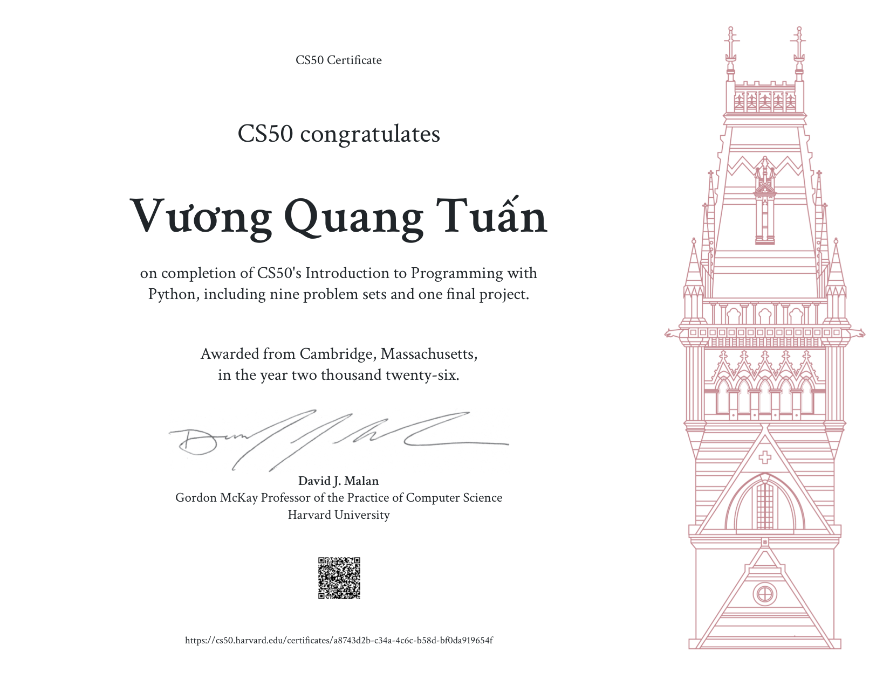
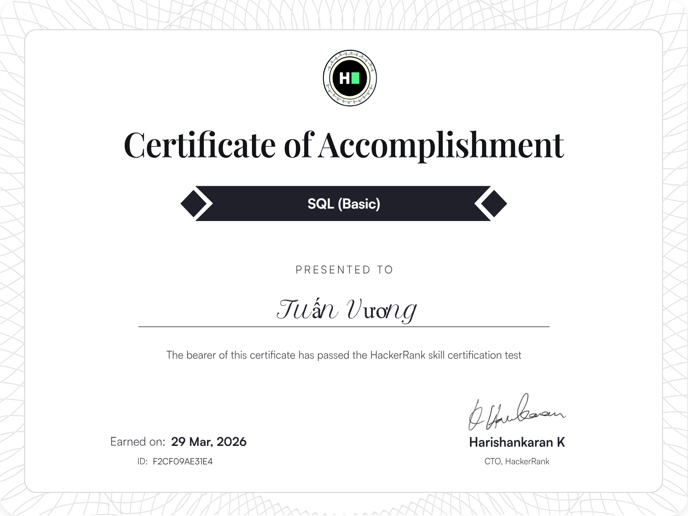
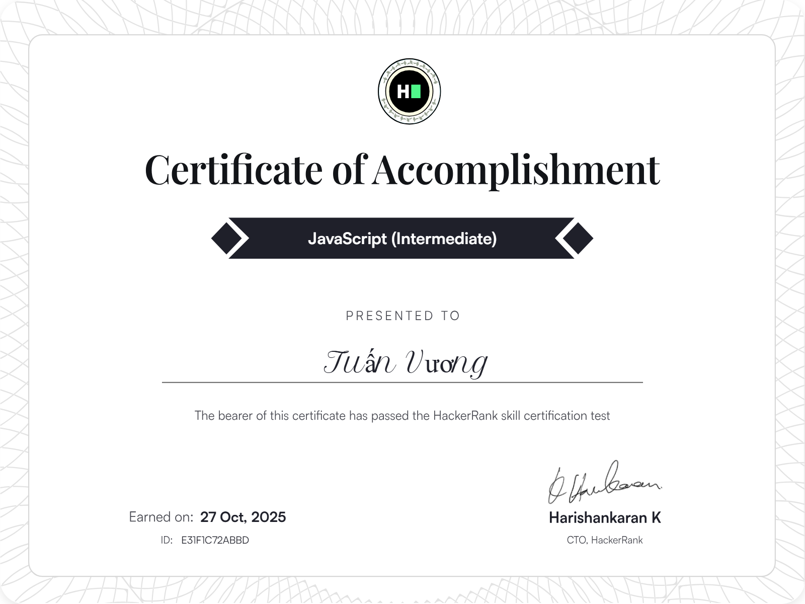

# 🏅 Certificate Portfolio · Vuong Quang Tuan

The certificates I have earned, with what each one covers and why it matters for my goal: working as a **web developer** (.NET, frontend, backend).

- 👤 Portfolio: [github.com/jasonvuong20032/jasonvuong](https://github.com/jasonvuong20032/jasonvuong)
- 💻 GitHub: [github.com/jasonvuong20032](https://github.com/jasonvuong20032)

---

## 📋 Overview

| # | Certificate | Issuer | Earned | Key skills | Verify |
|---|---|---|---|---|---|
| 1 | [CS50's Introduction to Programming with Python](#1-cs50s-introduction-to-programming-with-python-cs50p) | Harvard University (CS50) | 2026 | Python, unit tests, file I/O, regular expressions, OOP | [Verify](https://cs50.harvard.edu/certificates/a8743d2b-c34a-4c6c-b58d-bf0da919654f) |
| 2 | [SQL (Intermediate)](#2-sql-intermediate) | HackerRank | 29 Mar 2026 | Complex joins, unions, sub-queries | [Verify](https://www.hackerrank.com/certificates/f6708c1d8d4b) |
| 3 | [SQL (Basic)](#3-sql-basic) | HackerRank | 29 Mar 2026 | Simple queries, relationships, aggregation | [Verify](https://www.hackerrank.com/certificates/f2cf09ae31e4) |
| 4 | [JavaScript (Intermediate)](#4-javascript-intermediate) | HackerRank | 27 Oct 2025 | Design patterns, memory management, concurrency model, event loop | [Verify](https://www.hackerrank.com/certificates/e31f1c72abbd) |
| 5 | [JavaScript (Basic)](#5-javascript-basic) | HackerRank | 25 Oct 2025 | Functions, currying, hoisting, scope, inheritance, events, error handling | [Verify](https://www.hackerrank.com/certificates/2911fc05a883) |

## 🗺️ How they fit together

| Area of web development | Certificates | Where I apply it |
|---|---|---|
| Frontend (the browser) | JavaScript (Basic), JavaScript (Intermediate) | React + TypeScript storefront and back office |
| Database (the data) | SQL (Basic), SQL (Intermediate) | SQL Server schema, reports and dashboards |
| Programming fundamentals | CS50P | Clean functions, testing, regular expressions, scripting |

Together they cover the three layers I work with every day: the code that runs in the browser, the data behind it, and the general programming skills that hold everything together. The backend side (C#, ASP.NET Core) is shown through my projects, such as [VQT Japanese Food](https://github.com/jasonvuong20032/vqt-japanese-food).

---

## ℹ️ About HackerRank skill certifications

[HackerRank](https://www.hackerrank.com/skills-verification) is a coding-assessment platform that many companies use to screen developers. A skill certificate is earned by passing a **timed online test** in which the answers are working code (or SQL queries) that is graded automatically. **Basic** and **Intermediate** are two levels of the same skill; each test below has 2 questions. Every certificate has a public page and an ID, so anyone can check it.

---

## 1. CS50's Introduction to Programming with Python (CS50P)

| | |
|---|---|
| **Issuer** | Harvard University, CS50 (Prof. David J. Malan) |
| **Earned** | 2026 |
| **Requirements** | 9 problem sets and 1 final project |
| **Verify** | [cs50.harvard.edu/certificates/a8743d2b-…](https://cs50.harvard.edu/certificates/a8743d2b-c34a-4c6c-b58d-bf0da919654f) · [PDF](certificates/cs50p-introduction-to-programming-with-python.pdf) |

**What is it?**
Harvard's introduction to programming with Python, part of the CS50 family of courses. The certificate is only awarded after completing every problem set and a final project of my own design.

**What did I learn?**
The course's ten units: functions and variables, conditionals, loops, exceptions, libraries, **unit tests**, file I/O, **regular expressions**, **object-oriented programming**, and a final tour of further language features.

**Why does it matter?**
- It proves solid programming fundamentals in a second language besides C#, learned through hands-on problem sets rather than theory alone.
- Writing unit tests became a habit: my VQT Japanese Food project has 84 backend and 48 frontend automated tests.
- Regular expressions and exception handling are everyday tools in web development, for example validating phone numbers and coupon codes and turning failures into clear error messages.
- Python is useful next to .NET for scripts, automation and data processing.

---

## 2. SQL (Intermediate)

| | |
|---|---|
| **Issuer** | HackerRank |
| **Earned** | 29 Mar 2026 |
| **Test** | 35 minutes, 2 questions |
| **Topics** | Complex joins, unions, sub-queries |
| **Verify** | [hackerrank.com/certificates/f6708c1d8d4b](https://www.hackerrank.com/certificates/f6708c1d8d4b) · ID `F6708C1D8D4B` |

**What does it prove?**
That I can write queries that combine data from several tables (inner, outer and self joins), merge result sets with `UNION`, and nest queries inside other queries (sub-queries in `WHERE`, `FROM` and `SELECT`).

**Why does it matter?**
Real reports almost never come from a single table. In VQT Japanese Food, the best-seller list joins order lines with their orders and dishes and leaves out cancelled and refunded orders, and the "frequently bought together" suggestions look for dishes that appear in the same orders: both are join and sub-query problems. Even when an ORM such as Entity Framework writes the SQL, understanding these queries is what lets me read the generated SQL and make it fast and correct.

---

## 3. SQL (Basic)

| | |
|---|---|
| **Issuer** | HackerRank |
| **Earned** | 29 Mar 2026 |
| **Test** | 30 minutes, 2 questions |
| **Topics** | Simple queries, relationships, aggregators |
| **Verify** | [hackerrank.com/certificates/f2cf09ae31e4](https://www.hackerrank.com/certificates/f2cf09ae31e4) · ID `F2CF09AE31E4` |

**What does it prove?**
The foundations of working with a relational database: selecting, filtering and sorting data, understanding how tables relate through keys (one-to-one, one-to-many), and summarising data with aggregate functions (`COUNT`, `SUM`, `AVG`, `GROUP BY`, `HAVING`).

**Why does it matter?**
Every data-driven website depends on these basics. They are behind designing the tables and relationships of an application (VQT Japanese Food has 24 tables linked by keys) and behind the numbers a business looks at every day, such as revenue, number of orders and average order value.

---

## 4. JavaScript (Intermediate)

| | |
|---|---|
| **Issuer** | HackerRank |
| **Earned** | 27 Oct 2025 |
| **Test** | 1 hour 30 minutes, 2 questions |
| **Topics** | Design patterns, memory management, concurrency model, event loops |
| **Verify** | [hackerrank.com/certificates/e31f1c72abbd](https://www.hackerrank.com/certificates/e31f1c72abbd) · ID `E31F1C72ABBD` |

**What does it prove?**
That I understand how JavaScript actually runs: a single thread with an **event loop** that schedules callbacks, promises and `async`/`await`; how memory is managed and how leaks happen (for example timers and listeners that are never cleaned up); and common **design patterns** for structuring code.

**Why does it matter?**
Modern web frontends are asynchronous from top to bottom. In my React application, search requests wait until the user stops typing and outdated requests are cancelled, several requests that hit an expired session share one refresh instead of each starting their own, and components clean up their timers when they disappear. Getting these details wrong leads to race conditions, duplicated requests and memory leaks that are hard to debug.

---

## 5. JavaScript (Basic)

| | |
|---|---|
| **Issuer** | HackerRank |
| **Earned** | 25 Oct 2025 |
| **Test** | 1 hour 30 minutes, 2 questions |
| **Topics** | Functions, currying, hoisting, scope, inheritance, events, error handling |
| **Verify** | [hackerrank.com/certificates/2911fc05a883](https://www.hackerrank.com/certificates/2911fc05a883) · ID `2911FC05A883` |

**What does it prove?**
A solid grasp of the core language: functions as values, closures and currying, how hoisting and scope work (`var`, `let`, `const`), prototype-based inheritance and classes, handling browser events, and error handling with `try`/`catch` and custom errors.

**Why does it matter?**
These are the building blocks of every interactive page. Event handlers, closures inside React hooks and well-structured error handling all rely on them; for example, my frontend wraps every failed API call in a custom error class so the server's error code can be shown to the user as a clear, translated message.
